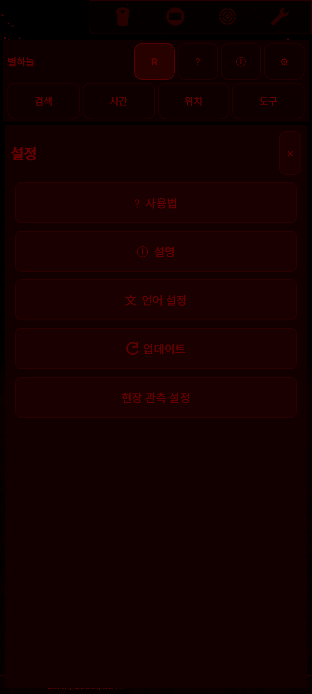
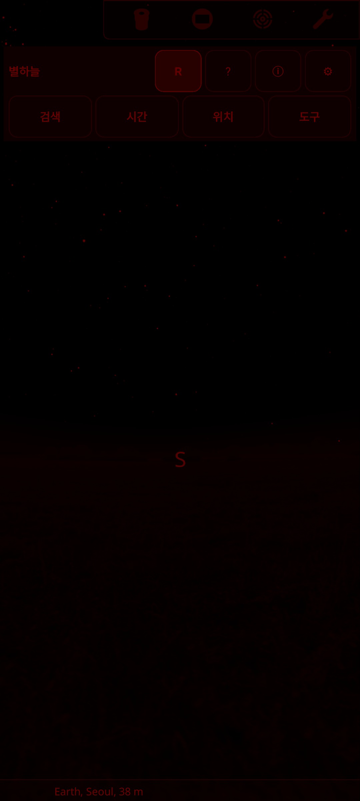

# v0.1.0 검증 결과

검토일: 2026-11-25. [실제 통과한 실행](https://github.com/by-jsk/stellarium-android/actions/runs/45630238047).
APK의 네이티브 입력은 `f1d4eea45ad21d2370ad9eb43f8045e6c5ed84b9`에서 빌드했으며,
이후 실행은 변경되지 않은 바이너리를 재사용하고 네이티브 소스 동일성을 확인했습니다.

- ARM64 APK: 63개 네이티브 라이브러리의 16KB ELF 정렬, ZIP 정렬, Android 16 SDK/패키지/버전, 고정 배포 인증서 검증 통과.
- [Android 16 일반 실행](android16.json): 5개 천체, 도시 DB, 시간/시간대, 6개 언어, 설정 순서, 영어 폴백, 독립 언어/지역 저장, 엔진 동작과 플러그인 즉시 로드 통과.
- [실제 16KB 페이지 실행](android15-16k.json): `getconf PAGESIZE=16384`, 동일 기능 검사 통과.
- 두 환경 모두 실제 한글 설정 화면의 비적색 픽셀 비율 0. 실제 × 버튼 터치 후 200만 개 이상 픽셀이 바뀌고 적색 하늘 화면으로 돌아옴.
- [업데이트 설치](upgrade.json): 코드 0 → 1 메타데이터 확인·다운로드·Android 설치 확인·완료·재실행, 한글 `ko`와 지역 `JP` 보존 통과. 일회용 CI 키와 에뮬레이터 로컬 서버를 사용한 시험이며, 배포 ARM64는 HTTPS와 별도 고정 배포키를 사용함.

소프트웨어 GPU 에뮬레이터의 FPS는 S25 성능 측정값이 아닙니다. S25 실기기, 실제 GPS·망원경·모든 플러그인 및 외부 서비스의 현장 검증은 별도 필요합니다. [기능별 범위](../../FEATURES.md).

